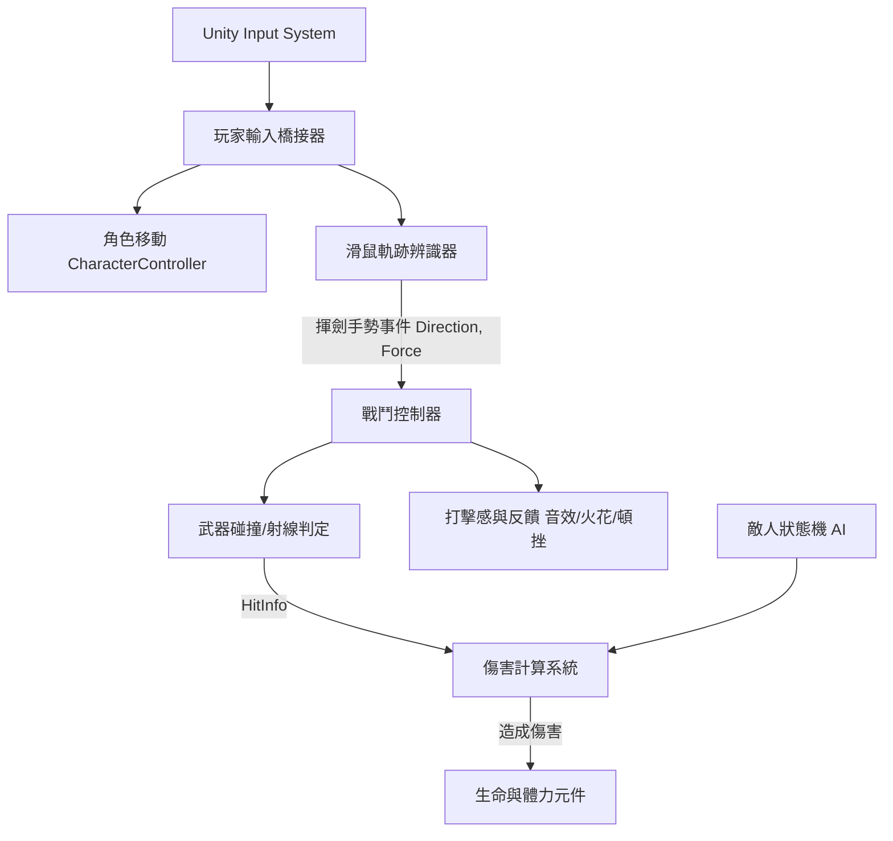

# ETHERBOUND — 遊戲技術總監與系統架構技能

本技能提供資深技術總監視角，負責引導《ETHERBOUND》專案從垂直切片（Vertical Slice）到開放世界的技術演進，確保 Unity 6 專案架構具備高內聚、低耦合、模組化與可擴展性。

---

## 1. 核心職責與工作原則

1. **模組解耦（Decoupling）**：
   - 嚴格禁止神級物件（God Class）。玩家輸入、攝影機控制、滑鼠軌跡計算、傷害判定、音效反饋必須各自獨立為不同腳本。
   - 核心系統間透過 C# 事件（`System.Action` / UnityEvent）或 ScriptableObject 事件進行通訊，避免直接相依。
2. **Unity 6 URP 最佳化實踐**：
   - 採用新版 `UnityEngine.InputSystem`（Input Action Asset）。
   - 物理檢測優先使用非分配記憶體的 API（如 `Physics.RaycastNonAlloc`、`Physics.OverlapSphereNonAlloc`）。
   - 採用物件池（Object Pooling）管理打擊火花粒子、音效與飄字。
3. **程式碼註解規範**：
   - 所有產出的 C# 程式碼註解皆強制採用繁體中文撰寫。

---

## 2. 建議之 Unity 專案資產結構（Assets Structure）

```text
Assets/
├── _Project/
│   ├── Animations/          # 角色與武器動畫、Animator Controller
│   ├── Audio/               # 劍擊、環境、UI 音效
│   ├── Materials/           # 材質球與 URP Shader Graph
│   ├── Prefabs/             # 玩家、敵人、武器、UI 預製物
│   │   ├── Characters/
│   │   ├── Weapons/
│   │   └── VFX/
│   ├── Scenes/              # 遊戲場景
│   │   ├── CombatArena.unity
│   │   └── Aelnos_Town.unity
│   ├── Scripts/             # 核心 C# 腳本模組
│   │   ├── Combat/          # 滑鼠軌跡、揮劍判定、連擊、格擋
│   │   ├── Player/          # 第一人稱移動、攝影機轉動、屬性
│   │   ├── Enemies/         # 敵方狀態機、AI 行為
│   │   ├── Core/            # 事件管理器、資料庫、單例管理
│   │   └── UI/              # 血條、體力、準心、軌跡提示 UI
│   └── Settings/            # Input Action、URP 資產、物理設定
```

---

## 3. 系統分層架構圖



---

## 4. 階段式推進 SOP（Roadmap Execution）

每當進入新開發輪次，依照以下步驟引導使用者：
1. **分析現狀**：確認專案目錄中既有的 Scripts 與 Prefabs。
2. **需求拆解**：將使用者目標拆分為「資料結構」、「控制邏輯」、「視覺反饋」、「測試方式」。
3. **明確分工**：
   - 明確標示哪些由 Antigravity 自動產出 C# 程式碼。
   - 明確列出需要在 Unity Inspector / Editor 中手動勾選或拖曳的設定（例如：Tag 設定、Layer 劃分、Collider 設定）。
4. **測試驗收指南**：提供直接可在 Unity Play Mode 中驗證的量化測試步驟。
