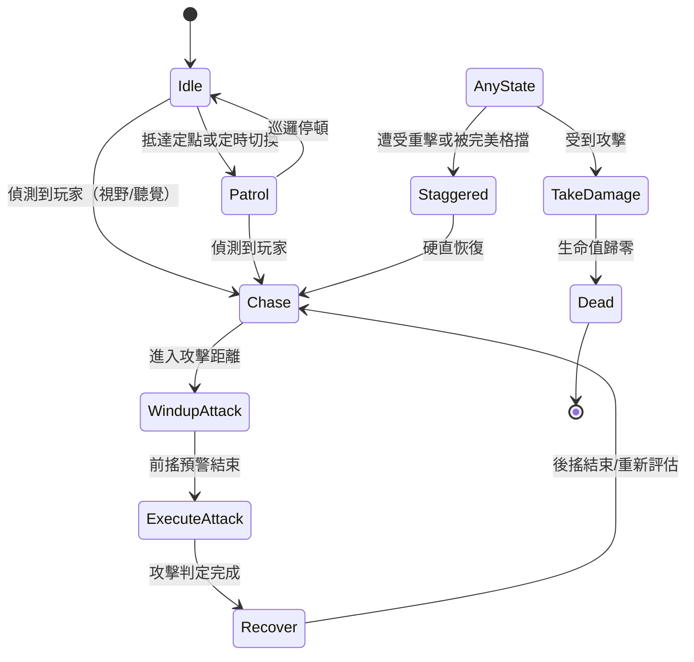

# Unity 動作 RPG 敵人戰鬥 AI 技能

本技能負責《PROJECT: ETHERBOUND》中的怪物、人形士兵與訓練木人 AI，建立具有威脅感、動作預警清晰、支援戰鬥反饋的敵人系統。

---

## 1. 核心架構：階層式狀態機（Hierarchical State Machine）

敵人具備以下核心狀態：

---

## 2. 戰鬥節奏與動作預警（Telegraphing）

魂系與第一人稱冷兵器戰鬥的關鍵在於**「可預測性」與「反制窗口」**：
1. **前搖蓄力（Windup / Telegraph）**：
   - 敵人出刀前需有明顯的舉刀蓄力動作或眼睛紅光特效（0.3 ~ 0.6 秒）。
   - 給予玩家預判揮劍格擋（Parry）的時間。
2. **出刀階段（Active Attack）**：
   - 啟用敵人武器的 Hitbox。
   - 依據攻擊軌跡進行傷害判定。
3. **後搖與破綻（Recovery / Cooldown）**：
   - 攻擊完畢後有 0.5 ~ 1.2 秒的硬直收刀時間，此時是玩家反擊的黃金時機。

---

## 3. 防禦型與菁英怪行為模式

- **持盾防禦（Blocking Guard）**：
  - 敵方舉盾時正面免疫輕斬傷害。
  - 玩家必須利用**滑鼠高速重斬**或**繞背攻擊**打破敵人防禦架勢。
- **霸體值（Poise / Super Armor）**：
  - 敵人擁有隱藏的平衡值（Poise）。輕斬只扣除生命不中斷其動作；連續攻擊或重斬將清空平衡值，觸發劇烈後仰（Stagger）。

---

## 4. 關鍵 C# 模組設計

- `EnemyBrain.cs`：狀態機主迴圈，管理狀態切換與冷卻時間。
- `EnemyMotor.cs`：利用 `UnityEngine.AI.NavMeshAgent` 處理尋路、轉向與走位保持間距。
- `EnemyCombat.cs`：管理攻擊判定、前後搖時間、連段邏輯。
- `EnemyHealth.cs`：生命值管理、受擊動畫觸發、死亡掉落物處理。
