# 《PROJECT: ETHERBOUND》不停進化型遊戲架構白皮書 (The Living Game)

本文件奠定《PROJECT: ETHERBOUND》的終極願景——打造一個**「不停自我演變、持續生長（Living & Evolving）」**的開放世界動作 RPG。

---

## 一、雙渦輪驅動進化矩陣 (Twin-Turbine Evolution Architecture)

遊戲由 **Antigravity** 與 **Gemini Task** 協同運作，實現代碼實體化與世界設定豐富的無縫循環：

```mermaid
graph LR
    subgraph Engine1["Gemini Task (每 1 小時定時進化)"]
        G1["讀取當前艾瑟里斯探索進度"] --> G2["生成新樓層生態 (層 2~100)"]
        G2 --> G3["產生以太天候異動 (極光/引力/虛空)"]
        G3 --> G4["生成新 NPC 人物線與失落劍技手卷"]
        G4 --> G5["自動寫入 world_state.json 與歷史日誌"]
    end

    subgraph Bridge["資料流與熱連動"]
        G5 -->|即時注入| DynamicWorld["src/lore/DynamicWorld.ts (遊戲運行端)"]
    end

    subgraph Engine2["Antigravity (Vibe Coding 核心)"]
        DynamicWorld --> A1["即時手感調校與流動式編碼"]
        A1 --> A2["將新設定實體化為 3D 幾何、音效與粒子"]
        A2 --> A3["自動化測試與 Vercel / GitHub 全球發布"]
    end
```

---

## 二、兩大主腦之權責分工

### 1. Antigravity 負責：Vibe Coding（感官體驗與代碼實體化）
- **職責**：遊戲第一線的感官設計師與系統工程師。
- **任務範疇**：
  - **打擊手感（Juice）**：調校滑鼠軌跡採樣靈敏度、三段式四向揮劍姿態、二階彈簧相機後座力。
  - **視覺與光影（3A Graphics）**：整合 NixieFX 劍光動態光軌（Ribbon Trail）、Ink Studio 水墨墨斑噴濺、ACESFilmic 色調映射。
  - **效能與部署**：確保在 WebGL 60 FPS 順暢運作，自動執行建置、打包並 `git push` 至 GitHub 與 Vercel。

### 2. Gemini Task 負責：世界設定持續擴充（Hourly World Evolution）
- **職責**：遊戲世界觀的永續編年史家與動態事件引擎。
- **任務範疇**：
  - **每 1 小時定時執行一次**（透過 Antigravity 自動化排程機制）。
  - 自動推進遊戲「紀元（Epoch）」，產生全新樓層情報（如第 2 層翡翠鐘乳石窟、第 3 層蒼穹星軌迴廊、第 4 層熔岩星鐵鍛爐...）。
  - 切換宏觀以太天候（提供全體玩家不同數值增益，如極光嵐提升 25% 劍氣傷害、引力突增提升 40% 破防值）。
  - 將每一次的世界演化記錄於 `docs/lore/world_evolution/`，形成真正的遊戲編年史。

---

## 三、世界進化與遊戲連動機制

- **遊戲端自動讀取**：
  遊戲前端透過 `DynamicWorld.ts` 即時同步 `world_state.json`，當玩家打開遊戲時，右上角任務看板將即時呈現當前的**「世界紀元」**與**「以太天候狀態」**，玩家的劍氣傷害與體力恢復速率將隨著天候自動改變！

---
*這座浮空遺跡塔「艾瑟里斯」，將伴隨時間的推移，永遠在玩家面前綻放嶄新的姿態。*
