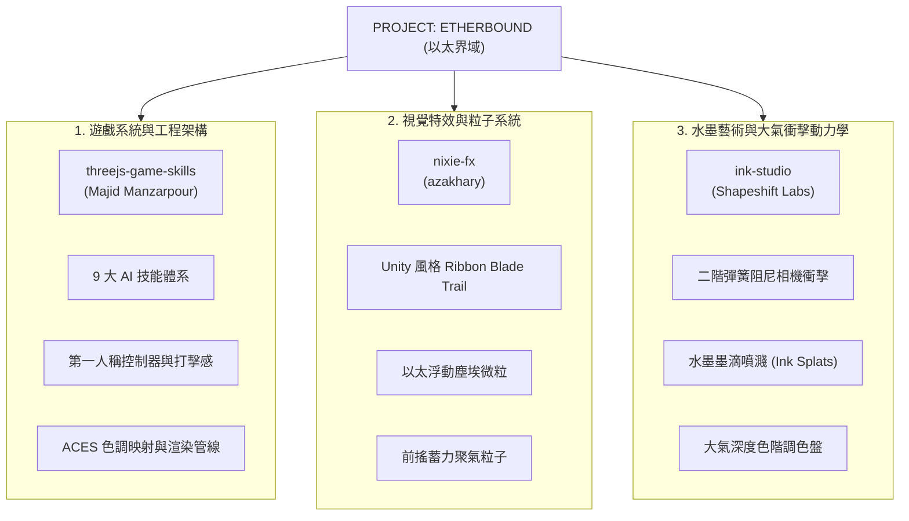

# PROJECT: ETHERBOUND — 三大核心 GitHub 參考體系與技術手冊

本專案融合了當前開源社群中最頂尖的三大 Web 3D / 遊戲開發 / 視覺特效開源專案，構建起一套完整、工業級的 AI 遊戲開發支柱體系。

---

## 🏛️ 三大支柱分工矩陣

---

## 📚 專案詳細對照與素材使用

### 第一支柱：[`threejs-game-skills`](https://github.com/majidmanzarpour/threejs-game-skills.git)
- **核心職責**：遊戲系統、玩法控制與專業 AI Agent 技能。
- **在本專案的實踐**：
  - 安裝了 9 套技能至 `.agent/skills/`，使 Antigravity 隨時能以 Director、Graphics Builder、Gameplay Systems、UI Designer 身分思考與編寫代碼。
  - 實現了滑鼠軌跡辨識、輕重斬數值計算與特殊劍技系統（[Q] 鍵以太劍氣波）。
  - 配置了 ACESFilmicToneMapping 與軟陰影最佳化。

### 第二支柱：[`nixie-fx`](https://github.com/azakhary/nixie-fx.git)
- **核心職責**：工業級粒子特效、Ribbon Trail 動態光軌與渲染管線。
- **在本專案的實踐**：
  - 引入 `nixie-fx-authoring` 與 `nixie-fx-runtime` 技能。
  - 實作 `src/vfx/BladeTrail.ts`：以四邊形帶狀網格（Ribbon Mesh）每幀採樣長劍世界座標，揮劍時拉出立體以太光芒光軌！
  - 實作 `src/vfx/AmbientParticles.ts`：空間漂浮 300 顆以太塵埃微粒，賦予世界充盈的魔法能量流動感。

### 第三支柱：[`shapeshift-labs-ink-studio`](https://github.com/siliconjungle/shapeshift-labs-ink-studio.git)
- **核心職責**：東方水墨藝術、筆觸墨暈、相機衝擊阻尼動力學與大氣調色。
- **在本專案的實踐**：
  - 建立 `ink-studio-stylization` 專屬技能。
  - 實作 `src/camera/CameraImpulse.ts`：以物理彈簧阻尼公式（$a = -kx - cv$）計算揮劍、命中與受擊時鏡頭的彈性後座力，打擊反饋極度厚重！
  - 實作 `src/vfx/InkSplatVFX.ts`：斬擊與劍氣爆發時，爆散出濃墨與以太青光的墨滴粒子（Ink Splats）。
  - 大氣調色：以墨夜黑、以太青與鎏金構成神話幻想色彩。
